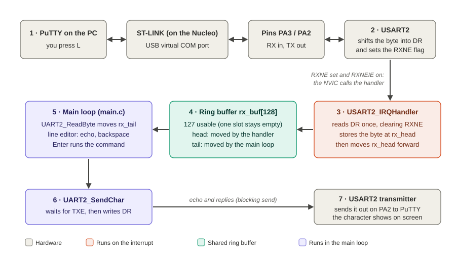
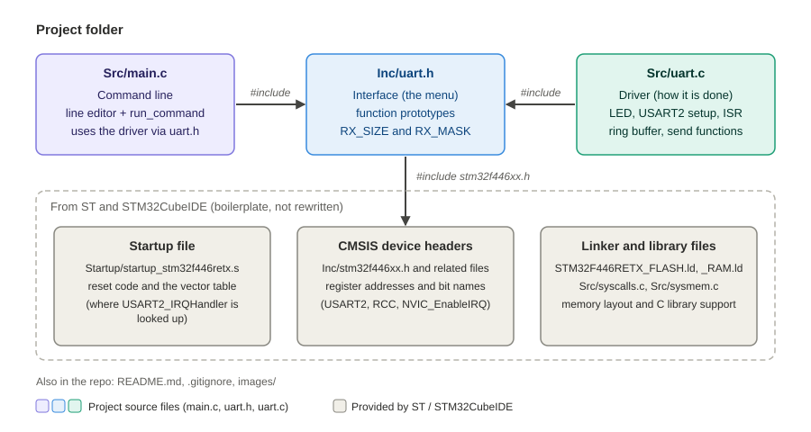

# STM32 Bare-Metal UART Driver

A bare-metal USART2 driver and serial command line for the STM32F446RE, written from the reference manual with direct register access and no HAL. Receive is interrupt-driven: the interrupt handler fills a ring buffer, and the main loop reads bytes out of it.

## What it does

- Serial link at 115,200 baud, 8N1, on USART2 (PA2 = TX, PA3 = RX), used from PuTTY
- Interrupt-driven receive: `USART2_IRQHandler` stores bytes in a 128-slot ring buffer (127 usable), and the main loop reads from it
- Error counters: counts bytes dropped because the buffer was full, and bytes lost to hardware overrun errors (ORE)
- Line editor: echo, backspace, and a limit of 63 characters per line
- Commands: turn the onboard LED on and off, and print the error counters

## Hardware and tools

| Item | Detail |
|---|---|
| Board | Nucleo-64: STM32F446RE (ARM Cortex-M4) |
| Clock | 16 MHz internal oscillator (HSI), PLL not configured |
| IDE | STM32CubeIDE 2.2.0 |
| Terminal | PuTTY |

## How it works

Pressing a key in PuTTY sends the byte over USB to the Nucleo's ST-LINK, and it arrives on pin PA3. USART2 shifts the byte into the data register (`DR`) and sets the `RXNE` flag. Because `RXNEIE` is enabled and the NVIC is configured, the CPU jumps to `USART2_IRQHandler`, which reads `DR` once and stores the byte in the ring buffer, or drops and counts it if the buffer is full. The main loop keeps calling `UART2_ReadByte` to pull bytes out of the buffer, builds the line being typed, echoes each character back with `UART2_SendChar`, and runs the command when Enter is pressed. The handler and the main loop touch each other only through the ring buffer, so the handler keeps receiving while the main loop is busy sending, until the buffer fills.

## Commands

| Command | Result |
|---|---|
| `LED ON` | Turns the onboard LED on (PA5) |
| `LED OFF` | Turns the onboard LED off (PA5) |
| `STATUS` | Prints the dropped and overrun counters |
| `HELP` | Lists the commands |

Anything else prints `unknown command`.

## Building and running

1. Open STM32CubeIDE and build the project.
2. Flash it to the board with the Run button.
3. Using device manager, find the STMicroelectronics STLink Virtual COM Port under Ports
4. Open PuTTY: connection type Serial, COM port, speed 115200 Baud, 8 data bits, 1 stop bit, no parity, no flow control.
5. Press the board's reset button, `STM32 CLI ready` should popup.

## Project layout

The program is split into three source files. `main.c` holds the command line, `uart.c` holds the driver (LED control, USART2 setup, the interrupt handler, the ring buffer, and the send functions), and `uart.h` is the interface between them, listing the functions `main.c` can call and the ring buffer size. `main.c` only talks to the driver through `uart.h` and never touches a register directly. The startup file, linker scripts, CMSIS headers, and the `syscalls.c` and `sysmem.c` files come from ST and STM32CubeIDE and were not rewritten.

## Design notes

### Baud rate

The USART divides its input clock by `BRR`, so the 16 MHz internal oscillator is divided by the 115,200 baud rate: `BRR = 16,000,000 / 115,200 = 138.9`. Because `BRR` has to be a whole number, the code adds half the divisor before dividing, which rounds to 139. The real baud rate is then `16,000,000 / 139 = 115,108`, which is 0.08% off the target and well within the roughly 2 to 3% a UART can tolerate.

### Receive path

Three things must be true for a received byte to reach the handler:

- The peripheral must request the interrupt (`RXNEIE` in `CR1`)
- The NVIC must let it through (`NVIC_EnableIRQ`)
- A function named `USART2_IRQHandler` must exist

The handler takes a snapshot of the status flags (`sr`), reads `DR` once (which clears `RXNE`), and increments the overrun count if `ORE` was set.

### Ring buffer

- `rx_head` is where the interrupt handler writes next, and `rx_tail` is where the main loop reads next.
- The buffer is empty when `head == tail` and full when `(head + 1) & RX_MASK == tail`. One slot stays empty so that full and empty can be told apart, which gives 127 usable slots.
- The size is a power of two (128), so `& RX_MASK` can wrap an index, which is faster than using `%`.
- When the buffer is full and a new byte arrives, it is dropped and counted. Unread data is never overwritten.

### Why no locks are needed

It is a single-producer, single-consumer queue, with each index having only one writer (the handler writes `head`, the main loop writes `tail`). The handler cannot be interrupted by the main loop, and an interrupt arriving in the middle of `UART2_ReadByte` is harmless. In the worst case, the main loop sees an empty buffer for one extra pass.

### Command line

The main loop handles each byte: Enter (`\r`) runs the command, `\n` is ignored, backspace (`0x08` or `0x7F`) removes a character, and printable ASCII (`0x20` to `0x7E`) is stored and echoed. The line buffer is 64 bytes: 63 usable characters, plus one slot for the `\0` terminator that `strcmp` needs.

## Test results

Tested on the board with PuTTY at 115200, 8N1.

| Test | Expected | Observed |
|---|---|---|
| `HELP` | Lists the four commands | Printed `Commands: LED ON, LED OFF, STATUS, HELP` |
| `LED ON` / `LED OFF` | LED turns on and off | LED turned on and off as commanded |
| `STATUS` at startup | `dropped: 0  overruns: 0` | `dropped: 0  overruns: 0` |
| Backspace edits a line | Correct command runs | Line edited correctly and the corrected command ran |
| Empty Enter | New prompt, no command | Printed a new prompt, no command ran |
| Paste 100 characters on one line | No crash, extra characters ignored | 63 characters echoed, the rest ignored, and commands still worked afterward |
| Reset, paste 50 lines of `HELP` back to back (298 characters), then `STATUS` | Bytes dropped and counted | `dropped` averaged about 93 |

## Known limitations

- Transmit is blocking: `UART2_SendChar` spins on `TXE`, so a long burst of input can overflow the ring buffer (see the last test above). Next step: an interrupt-driven transmit buffer.
- Framing and noise errors are not handled.
- Assumes a 16 MHz clock: if the PLL is configured, `BRR` must be recomputed.
- Testing was manual. A known-load test that checks the `STATUS` counters would give a measured result.

## References

- RM0390: STM32F446xx reference manual (registers and peripherals)
- STM32F446xx datasheet (pinout and alternate function table)
- UM1724: Nucleo-64 user manual (LED on PA5, ST-LINK virtual COM port)